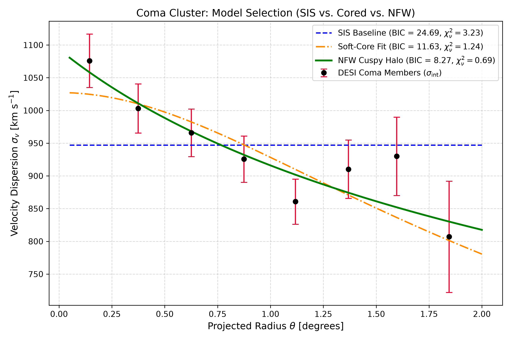
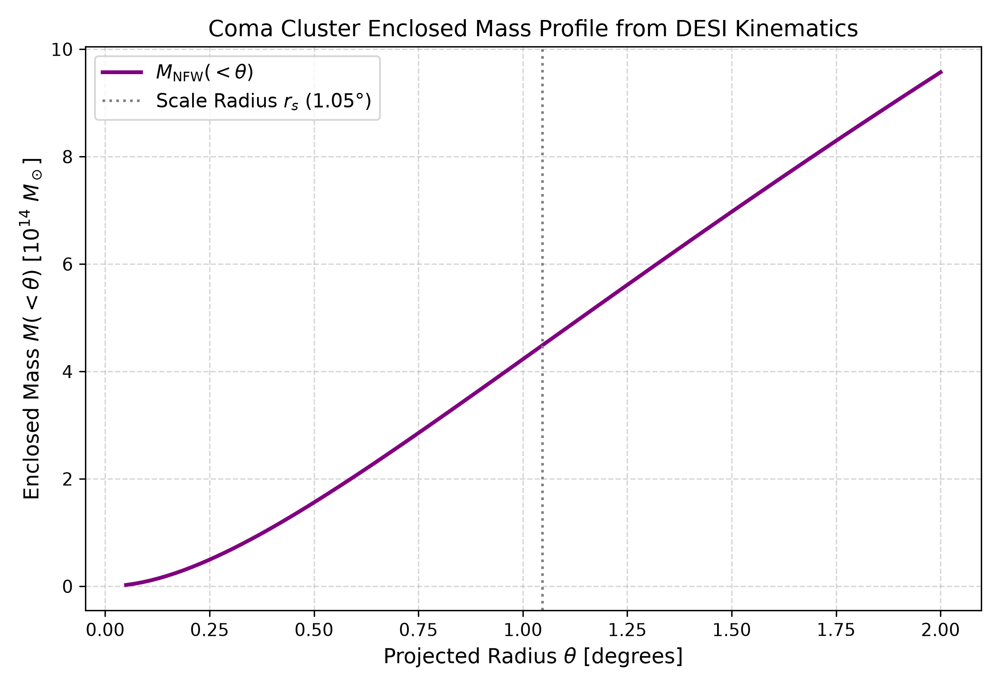

# Mapping the Dark Matter Profile of the Coma Cluster with DESI

This project is an observational and dynamical study of the **Coma Cluster (Abell 1656)** using spectroscopic galaxy kinematics from the **Dark Energy Spectroscopic Instrument (DESI)** Iron Data Release. 

Nearly a century after Fritz Zwicky first used galaxy velocity dispersions in Coma to infer the existence of "dunkle Materie," DESI provides thousands of precise redshifts across the cluster field. In this work, I isolate member galaxies, construct a line-of-sight velocity dispersion profile out to the cluster's virial boundary, and test whether cluster-scale dark matter halos favor a cuspy Navarro-Frenk-White ($\Lambda\text{CDM}$) profile or a cored distribution.

A full draft of the manuscript prepared with the AAS TeX template is available in [`paper/aas_template.tex`](paper/aas_template.tex) (compiled PDF: [`paper.pdf`](paper.pdf)).

---

## What This Project Does

1. **Member Selection from DESI Iron**:
   From the primary DESI Iron redshift catalog (`zall-pix-iron.fits`), I selected high-confidence galaxies (`SPECTYPE == 'GALAXY'`, `ZWARN == 0`, `ZCAT_PRIMARY == True`) within a $2.0^\circ$ cone centered on Coma $(\alpha = 194.953^\circ, \delta = 27.981^\circ)$. Applying relativistic Doppler velocity calculations and an iterative $3\sigma$ interloper cut yields a clean kinematic sample of **$N = 2,098$ member galaxies**.

2. **Kinematic Profile Extraction**:
   Member galaxies were grouped into 8 concentric radial annuli ($\Delta \theta = 0.25^\circ$). To get the true physical velocity dispersion, spectrographic measurement uncertainties were subtracted in quadrature. The resulting profile starts at $\sim 1076\text{ km s}^{-1}$ in the dense core and falls off to $\sim 807\text{ km s}^{-1}$ near the virial boundary, with a localized bump around $1.4^\circ$ associated with the infalling NGC 4839 group.

3. **Jeans Modeling & Halo Model Selection**:
   I tested three theoretical halo profiles against the measured velocity dispersion profile using non-linear least-squares fitting and the Bayesian Information Criterion (BIC):
   - **Singular Isothermal Sphere (SIS)**: Assumes a scale-free $\rho \propto r^{-2}$ falloff and a constant velocity dispersion.
   - **Soft-Core (Plummer-like)**: Removes the central density cusp with a flattened core.
   - **Navarro-Frenk-White (NFW)**: The standard cuspy dark matter profile predicted by $\Lambda\text{CDM}$ cosmological simulations ($\rho \propto r^{-1}$ centrally, $\rho \propto r^{-3}$ in the outskirts).

4. **Dynamical Mass Estimation**:
   Integrating the Jeans equation for the best-fit NFW potential yields Coma's scale radius, enclosed radial mass profile $M(<r)$, and virial mass ($M_{200}$).

---

## Results & Findings

### Halo Model Comparison

The flat Singular Isothermal Sphere model fails to describe the cluster kinematics, severely missing both the core peak and the outer decline. While a soft-core model performs better, the **cuspy NFW profile provides the best description** of the DESI data, fitting the entire radial span with a reduced $\chi_\nu^2 = 0.69$.

| Profile | Parameters | Best-Fit Value | $\chi^2$ | d.o.f. | $\chi_\nu^2$ | BIC | $\Delta \text{BIC}$ |
| :--- | :---: | :---: | :---: | :---: | :---: | :---: | :---: |
| **Singular Isothermal Sphere (SIS)** | $\sigma_0$ | $946.99 \pm 14.69\text{ km s}^{-1}$ | 22.61 | 7 | 3.23 | 24.69 | $+16.42$ |
| **Soft-Core** | $\sigma_{0,c}, \theta_c$ | $1027.35\text{ km s}^{-1}, 1.41^\circ$ | 7.47 | 6 | 1.24 | 11.63 | $+3.36$ |
| **NFW (Cuspy CDM)** | $\sigma_{\text{max}}, \theta_s$ | $1093.30 \pm 42.66\text{ km s}^{-1}, 1.05^\circ \pm 0.35^\circ$ | **4.11** | **6** | **0.69** | **8.27** | **0.00** |

*Figure 1: Observed intrinsic line-of-sight velocity dispersion profile (points with error bars) plotted against the SIS baseline (blue dashed), Soft-Core fit (orange dash-dotted), and NFW cuspy halo (green solid).*

### Mass Estimates & Literature Context

At an assumed distance of $D \approx 98.9\text{ Mpc}$ ($z \approx 0.0231$, $H_0 = 70\text{ km s}^{-1}\text{Mpc}^{-1}$), the fitted NFW scale angle corresponds to a physical scale radius of $r_s \approx 1.81\text{ Mpc}$.

- **Virial Mass ($r_{\text{vir}} \approx 2.0\text{ Mpc}$)**: $M_{\text{vir}} = (5.11 \pm 0.45) \times 10^{14} \, \mathrm{M}_\odot$
- **Total Enclosed Mass within $2.0^\circ$ ($\approx 3.45\text{ Mpc}$)**: $M(<2.0^\circ) = 9.57 \times 10^{14} \, \mathrm{M}_\odot$

*Figure 2: Enclosed mass profile $M(<\theta)$ computed by integrating the NFW potential. The dotted vertical line marks the scale radius $r_s \approx 1.05^\circ$ ($1.81\text{ Mpc}$).*

These dynamical estimates agree well with independent multi-wavelength literature for Coma:
- **Historical optical kinematics**: Łokas & Mamon (2003) obtained $(5\text{--}7) \times 10^{14} \, \mathrm{M}_\odot$ from 445 galaxies. The DESI sample increases member statistics nearly fivefold.
- **X-ray hydrostatic mass**: Measurements from *ROSAT*, *XMM-Newton*, and *Chandra* report $M_{200} \approx (5.0\text{--}6.5) \times 10^{14} \, \mathrm{M}_\odot$.
- **Weak lensing & Planck SZ**: Gravitational lensing and Sunyaev-Zel'dovich cluster profiles place $M_{200}$ in the range $(5.5\text{--}7.5) \times 10^{14} \, \mathrm{M}_\odot$.

The consistency across optical kinematics, ICM X-ray gas, and weak lensing reinforces that Coma is close to dynamical equilibrium within its virial boundary and well described by a standard $\Lambda\text{CDM}$ cuspy halo.

---

## Repository Files

- `data_prep.py`: Initial parser filtering the raw DESI Iron FITS catalog into a manageable tabular format.
- `data_filter_calc.py`: Converts redshifts into relativistic Doppler velocities, applies coordinate cone cuts, and runs iterative $3\sigma$ velocity clipping.
- `calc_n_model_plot.py`: Extracts the annular velocity dispersion profile, fits the halo models, computes BIC values, and generates the figures.
- `coma_galaxy_data.csv`: The cleaned sample of $N = 2,098$ confirmed Coma member galaxies.
- `paper/aas_template.tex`: Complete LaTeX manuscript drafted in AAS TeX 6.31 format.
- `paper.pdf`: Compiled version of the manuscript.

---

## License
[MIT License](LICENSE)

